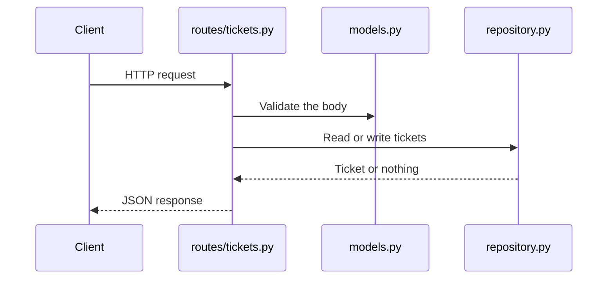

# Architecture

The API is four Python modules and one test module. The shape is small so a lab can spend its time on agent-ready repository structure.

## Request flow

FastAPI validates path parameters and the Pydantic body before the route function runs. `app/main.py` turns validation failures into HTTP 422 and `{"detail": "<message>"}`. The route raises HTTP 404 when the repository returns nothing. Route code returns that message directly. It does not place a traceback or `str(exc)` in the response.

## Module responsibilities

| Module | Owns | Does not own |
| --- | --- | --- |
| `app/main.py` | Application construction and error responses | Ticket rules or storage |
| `app/models.py` | Field shapes, limits, and the status enum | HTTP status codes |
| `app/repository.py` | The in-memory dictionary, ids, and `reset()` | Request parsing |
| `app/routes/tickets.py` | Paths, status codes, and calls into the repository | A second copy of the stored data |
| `tests/test_tickets.py` | Observable HTTP behavior | Private dictionary assertions |

## Dependency direction

- `main.py` imports the ticket router.
- `routes/tickets.py` imports models and the `ticket_repository` singleton.
- `repository.py` imports models.
- Models import neither routes nor the repository.
- Tests import the public `app` and call `ticket_repository.reset()` so each test starts empty.

There is no service class, interface, or dependency-injection framework. The route function is the HTTP behavior.

## Where a change goes

| Change | Location |
| --- | --- |
| A new field or status value | `app/models.py` |
| How a ticket is stored or looked up | `app/repository.py` |
| A path, status code, or response | `app/routes/tickets.py` |
| What callers can observe | `tests/test_tickets.py` |

Validation of request data belongs in the Pydantic models. FastAPI runs it before the route body. The route checks whether a ticket exists and chooses 200, 201, or 404.

Storage behavior belongs in `TicketRepository`. Routes call `create`, `list_tickets`, `get`, and `update_status`. They do not touch `_tickets`.

Tests belong in `tests/test_tickets.py`. They call the API with `TestClient`. The autouse fixture resets the repository so a test can run alone or in any order.

## Adding an endpoint

1. Add or extend the Pydantic models the endpoint accepts and returns.
2. Add the route on the existing router, with an explicit `response_model` and status code.
3. Add a repository method when the endpoint needs new storage behavior.
4. Add behavioral tests for success and failure.

The order of work, including the failing test first, is the `add-endpoint` skill.

## Why this stays small

A service layer would repeat the route functions. A database would move the lesson onto infrastructure. The in-memory repository is enough to show a real boundary: HTTP code depends on storage code, and tests reset that storage through one method. See [0001-in-memory-storage.md](decisions/0001-in-memory-storage.md).

## Current status behavior

`update_status` stores any `TicketStatus`. A resolved ticket can be set back to `open`. That is deliberate base behavior. Task 4 in [TASKS.md](TASKS.md) documents the edge case students tighten.
